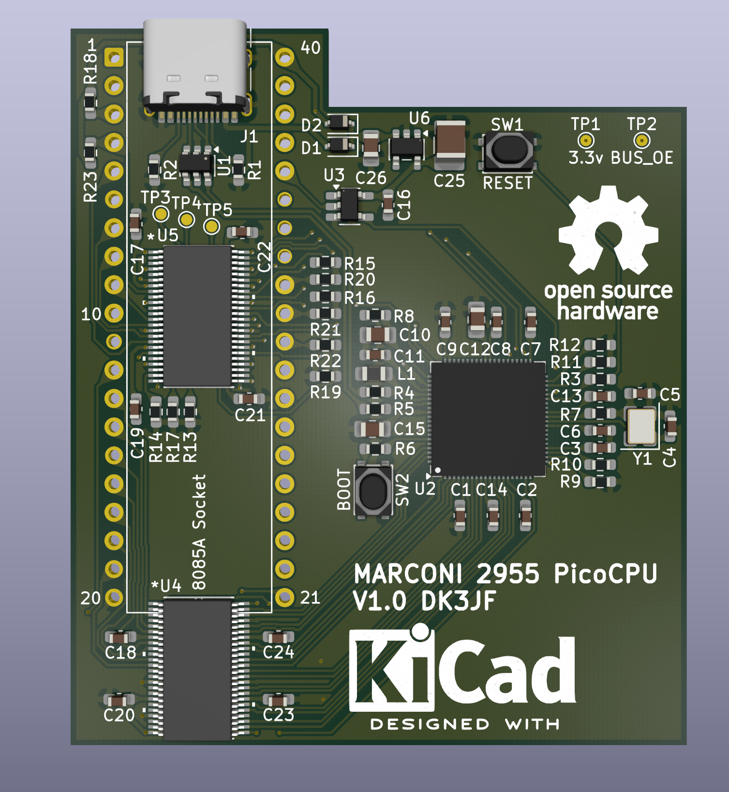

# Hardware

Add-on boards for the Marconi 2955, as KiCad projects with Gerber files.

| Folder | Board |
|---|---|
| `step-attenuator/` | Solid-state replacement for the coarse step attenuator |
| `om345-replacement/` | Replacement for the OM345 hybrid amplifier, using a MAR-7SM+ |
| `om345-testrig/` | Test fixture for measuring an OM345 or a replacement board |
| `10mhz-to-1mhz/` | Converts a 10 MHz reference signal to 1 MHz |
| `cpu-adapter/` | RP2354B board for the 8085 socket, runs the new firmware (v1.0, not built or tested yet; see its SPEC.md) |

## CPU adapter

The RP2354B board that replaces the 8085 on AB4. Specification and status:
[cpu-adapter/SPEC.md](cpu-adapter/SPEC.md).

## Licence

The board designs in this folder are open hardware under the CERN Open Hardware Licence
Version 2, Strongly Reciprocal (CERN-OHL-S-2.0). See [LICENSE](LICENSE).

## Note on the MAR-7SM+ footprint

The symbol and footprint library for the MAR-7SM+ is not included, because its licence does not
allow it to be passed on as a library. It comes from SamacSys. The board file still contains the
footprint, so the board opens and can be fabricated as it is. To change the footprint, get the
library for the MAR-7SM+ yourself and add it to the project as a library called `RF`.

## Note on the CPU adapter's libraries and 3D models

The KiCad library for the SN74LVC16245ADGGR (from TI) and the STEP models for the RP2354B, the
TSSOP-48 translators and the USB-C receptacle are not included, because their licences are
unclear or do not allow them to be passed on. The board file still contains all footprints, so
the board opens and can be fabricated as it is; only the 3D view lacks those parts.
