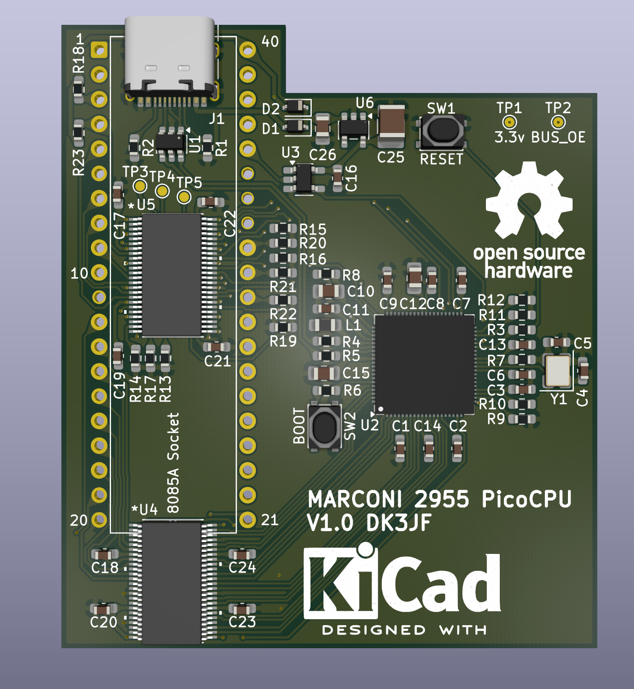

# CPU adapter: RP2354B in the 8085 socket

A small board that plugs into the 8085 socket on board AB4, the processor board, in place of
the 8085 (IC1 on the AB4 circuit diagram). An RP2354B runs the new firmware from `fw/` and
works the instrument's bus as an 8085 would. The original EPROMs, RAM, EEPROM and NOVRAM stay on AB4. With the 8085 put
back into the socket, the instrument runs its original firmware again.

This document is the specification for the schematic and the layout. The firmware for it is in
`fw/target_rp2350/`.

Status: board v1.0 is laid out (`Marconi_2955_PikoCPU.kicad_pro`, Gerber files in `gerber/`)
but not built or tested yet. Points still to be measured are listed at the end.

## Board v1.0 as built

The KiCad project uses other reference designators than this specification and differs from it
in a few points:

| This specification | Board v1.0 |
|---|---|
| U1 (address and data translator) | U4 |
| U2 (control and input translator) | U5 |
| U3 (Schmitt buffer) | U3 |
| U4 (RP2354B) | U2 |
| U5 (LDO) | U6, AP2112K-3.3 |
| U6 (USB ESD protection) | U1, USBLC6-2SC6 |
| D2, D3 (diode-OR) | D1, D2, PMEG6010CEJ |
| J1, J2 (socket pins) | J2, 1.0 mm drills |
| J3 (USB-C) | J1, HRO TYPE-C-31-M-12, top-mount |
| strobe resistors | R20-R22, 33 R |

- No SWD connector (J4), no LED and no UART test pads. SWCLK and SWDIO are not brought out;
  flashing goes over USB.
- SW1 (RUN, marked RESET) and SW2 (BOOTSEL, marked BOOT) are C&K PTS810, pressed from the top,
  so they can only be reached with the board out of the instrument. `picotool load -f` can reboot
  the running firmware into BOOTSEL over USB instead.
- Test pads: TP1 3.3 V, TP2 /BUS_OE, TP3-TP5 on U5 1B6-1B8 (GPIO 22, 30, 31).
- GPIO 35-37 are not connected; U5 2B6-2B8 have 10 k pull-downs and 2A6-2A8 are open.
- Outline 55 x 64 mm, checked on the instrument. The cutout for LK1 and the test points starts
  23 mm from the left edge, is 7 mm deep and runs to the right edge.
- Four layers (In1 ground, In2 3.3 V), JLCPCB stackup JLC04101H-3313A, 0.97 mm. USB D+ and D-
  are routed as a 90 ohm differential pair, 0.26 mm wide with 0.20 mm spacing, on that stackup.
- Signal tracks 0.15 mm with 0.15 mm clearance, vias 0.3 mm drill and 0.45 mm diameter.

## What the board has to do

- Drive AD0-7 (address low byte, then data), A8-15, ALE, /RD and /WR like an 8085.
- Read the data bus during /RD.
- Drive RESET OUT (it resets the GPIB board) and SOD (it lets the VARIABLE knob, not the tones
  timer, drive RST 7.5).
- Read RST 5.5, RST 6.5, RST 7.5, SID and /RESET IN.
- Never write to the bus while it is starting or while the instrument's power is failing.
  A stray write can corrupt the calibration data in the EEPROM (IC13).

## The 8085 socket on AB4

From the AB4 circuit diagrams (service manual, AB4 sheets 1-3). The pins not shown on the
diagrams were checked with a meter on the instrument.

| Pin | 8085 | On AB4 | On the adapter |
|---|---|---|---|
| 1 | X1 | 5 MHz clock from AB3. It also feeds the Am9513 and the prescalers. | Input, U2 2B5, GPIO 29 (spare, not needed) |
| 2 | X2 | Not connected | NC |
| 3 | RESET OUT | GPIB board reset (active high) | Output, U2 1B4, GPIO 20; 10 k pull-up to 5 V |
| 4 | SOD | High enables the VARIABLE knob on RST 7.5, low selects the tones timer | Output, U2 1B5, GPIO 21; 10 k pull-up to 5 V |
| 5 | SID | Knob direction (IC29, 74LS74) | Input, U2 2B4, GPIO 27 |
| 6 | TRAP | Held inactive through LK2 and IC25 | NC |
| 7 | RST 7.5 | Knob step or tones timer (IC27, 74LS00) | Input, U2 2B3, GPIO 26 |
| 8 | RST 6.5 | Key pressed latch (IC37, 74LS74) | Input, U2 2B2, GPIO 25 |
| 9 | RST 5.5 | GPIB interrupt, 15 k pull-down | Input, U2 2B1, GPIO 24 |
| 10 | INTR | Grounded by a wire link to pin 20 | NC |
| 11 | /INTA | Not connected | NC |
| 12-19 | AD0-AD7 | Data bus and 74LS373 address latch (IC2) | Both ways, U1 1B1-1B8, GPIO 0-7 |
| 20 | VSS | Ground | GND |
| 21-28 | A8-A15 | Address bus | Output, U1 2B1-2B8, GPIO 8-15 |
| 29 | S0 | Not connected | NC |
| 30 | ALE | Address latch IC2, ADC control IC24 | Output, U2 1B1, GPIO 16; 10 k pull-down |
| 31 | /WR | Write strobe | Output, U2 1B3, GPIO 18; 4.7 k pull-up to 5 V |
| 32 | /RD | Read strobe | Output, U2 1B2, GPIO 17; 4.7 k pull-up to 5 V |
| 33 | S1 | Not connected | NC |
| 34 | IO/M | Not connected: all decoding uses A11-A15 | NC |
| 35 | READY | 4.7 k pull-up, always ready | NC |
| 36 | /RESET IN | RC power-on reset (100 k, 33 uF), TP1 | Input through Schmitt buffer U3, GPIO 28 |
| 37 | CLK OUT | Not connected | NC |
| 38 | HLDA | Not connected | NC |
| 39 | HOLD | Grounded | NC |
| 40 | VCC | +5 V | Supply for the adapter |

All chips that read the bus are LS TTL or have TTL-level inputs (74LS373, 74LS138, 74LS139,
74LS32, 74LS02, 74LS245, 27128/2764, X2816A, HM6116, X2210, uPD7210, Am9513). They read a
3.3 V high level reliably (V_IH = 2.0 V).

## Level translation

**Use two 74LVC16245A (or 74LVCH16245A without bus hold, see below), supplied from 3.3 V.**

The 74LVC16245A works from 3.3 V, and all its pins accept 5 V. Its inputs switch at TTL levels.
That suits this bus in both directions:

- Towards the instrument it drives 3.3 V, which the TTL inputs read as high.
- From the instrument it reads TTL outputs. Their high level can be as low as 2.4 V
  (EPROMs, NMOS parts) or 2.7 V (74LS).

A dual-supply translator such as the 74LVC16T245 does **not** work here. With its B side on 5 V
it needs at least 3.5 V for a high input, and TTL outputs do not reach that.

Avoid the bus-hold variant (74LVCH16245A) on U1: bus hold on the data lines can fight weak
drivers during reads. It is fine on U2.

### U1: address and data

| Half | A side (RP2354B) | B side (socket) | DIR | /OE |
|---|---|---|---|---|
| 1 | GPIO 0-7 | AD0-7 | GPIO 19 (high = towards the socket) | /BUS_OE |
| 2 | GPIO 8-15 | A8-15 | 3.3 V (towards the socket) | /BUS_OE |

### U2: control lines and inputs

| Half | Channel | A side | B side | Direction |
|---|---|---|---|---|
| 1 | 1 | GPIO 16 | ALE (pin 30) | DIR = 3.3 V, towards the socket, /OE = /BUS_OE |
| 1 | 2 | GPIO 17 | /RD (pin 32) | |
| 1 | 3 | GPIO 18 | /WR (pin 31) | |
| 1 | 4 | GPIO 20 | RESET OUT (pin 3) | |
| 1 | 5 | GPIO 21 | SOD (pin 4) | |
| 1 | 6-8 | GPIO 22, 30, 31 | test pads | |
| 2 | 1 | GPIO 24 | RST 5.5 (pin 9) | DIR = GND, towards the RP2354B, /OE = GND (always on) |
| 2 | 2 | GPIO 25 | RST 6.5 (pin 8) | |
| 2 | 3 | GPIO 26 | RST 7.5 (pin 7) | |
| 2 | 4 | GPIO 27 | SID (pin 5) | |
| 2 | 5 | GPIO 29 | X1, 5 MHz (pin 1) | |
| 2 | 6-8 | GPIO 35-37 | test pads, 10 k pull-down each | |

Tie unused inputs on either side to a defined level; do not leave CMOS inputs floating.

### U3: reset input

/RESET IN is a slow RC ramp. Feed it through a Schmitt-trigger buffer, 74LVC1G17 (SOT-23-5)
on 3.3 V, to GPIO 28. Its input accepts 5 V. A plain translator input could oscillate on the
slow edge.

### Knob and key inputs

From AB4 sheet 1. The knob delivers two phase-shifted signals, A on connector pin 2a and B on
connector pin 2b.

- SID comes from IC29a (74LS74). Its D input is A and its clock is B, so each rising edge of B
  stores the direction: high for clockwise, low for anticlockwise. SID then holds until the
  next rising edge of B.
- RST 7.5 is a multiplexer built from IC27 (74LS00): (B and SOD) or (not SOD and tones timer).
  With SOD high, RST 7.5 is simply B, two gate delays later.
- RST 7.5 and SID therefore change on the same edge, within a few tens of nanoseconds of each
  other. SID is valid from then until the next step of the knob. The firmware reads SID in the
  GPIO interrupt about 1-2 us after the edge, well inside that window. The original 8085
  reads it later still, in its interrupt routine. A measurement is not needed.
- RST 6.5 is Q of IC37 (74LS74). It is clocked by the key-pressed line through an RC filter
  (R44 470 R, C36 4.7 uF) and cleared from the control latch (sheet 2, IC19 pin 15). This is
  the latch that the firmware clears through EE00 bit 5 after reading a key.

## RP2354B GPIO use

| GPIO | Use |
|---|---|
| 0-7 | AD0-7 (PIO, in and out) |
| 8-15 | A8-15 (PIO) |
| 16, 17, 18, 19 | ALE, /RD, /WR, AD direction (PIO side-set, must be consecutive in this order) |
| 20 | RESET OUT |
| 21 | SOD |
| 22 | spare output (U2 1B6, test pad) |
| 23 | /BUS_OE: low enables U1 and U2 half 1. 10 k pull-up to 3.3 V |
| 24-27 | RST 5.5, RST 6.5, RST 7.5, SID |
| 28 | /RESET IN (from U3) |
| 29 | 5 MHz (spare) |
| 30, 31 | spare outputs (U2 1B7, 1B8, test pads) |
| 32, 33 | UART0 TX, RX: debug test pads |
| 34 | LED (0603, about 1 k to GND) |
| 35-37 | spare inputs (U2 2B6-2B8) |
| 38-47 | free; bring out to test pads where space allows |

GPIO 0-15 must stay in this order: the PIO writes the 16 address bits in one go and reads
AD0-7 as one byte.

## Safe start and stop

The bus must stay quiet until the firmware has set it up:

- /BUS_OE has a 10 k pull-up to 3.3 V. U1 and the outputs of U2 stay off until the firmware pulls
  it low.
- On the socket side: /RD and /WR 4.7 k to 5 V, ALE 10 k to GND, RESET OUT 10 k to 5 V (the
  GPIB chip stays in reset), SOD 10 k to 5 V.
- The firmware waits for /RESET IN to go high, like the 8085, before it starts the bus.
- When /RESET IN falls (power failing or TP1 shorted), the firmware switches /BUS_OE off at once
  and restarts when the line is high again.

When U2 drives /RD or /WR high at 3.3 V, about 0.4 mA flows from the 5 V pull-ups into U2's
supply. That is harmless.

## Bus timing

The firmware produces these times (one PIO step is 100 ns):

| | Adapter |
|---|---|
| ALE high | 200 ns |
| Address held after ALE falls | 200 ns |
| /RD low | 800 ns |
| /WR low | 700 ns |
| Data held after /WR rises | 200 ns |
| Gap between two bus cycles | at least 1.9 us |

They are meant to be longer than those of the 8085A with the instrument's 5 MHz crystal
(2.5 MHz internal clock, 400 ns per T state). Between two data accesses a real 8085 always
fetches at least one opcode, which takes 4 T states (1.6 us); the gap keeps slow chips such as
the Am9513 at their usual pace. The times are to be checked against a logic analyzer recording
of the original 8085 and can be changed in `fw/target_rp2350/bus.pio`.

## Parts

All parts must be flat; see the height budget below. No electrolytic capacitors. **Passive
parts no smaller than 0603.** The only fine-pitch parts are the RP2354B (QFN-80, 0.4 mm pitch)
and the two translators (TSSOP-48, 0.5 mm pitch); there are no larger packages for them.

| Ref | Part | Package | Notes |
|---|---|---|---|
| U4 | RP2354B | QFN-80 10 x 10 mm | 2 MB flash inside the package |
| U1, U2 | 74LVC16245A | TSSOP-48 | 3.3 V |
| U3 | 74LVC1G17 | SOT-23-5 | Schmitt buffer for /RESET IN |
| U5 | 3.3 V LDO, at least 300 mA, for example AP2112K-3.3 | SOT-23-5 | fed from socket pin 40 or USB VBUS, see Power |
| D2, D3 | Schottky diode, at least 0.5 A, for example BAT60A or PMEG2005 | SOD-323 or SOD-123 | the diode-OR in front of U5 |
| U6 | USB ESD protection, for example USBLC6-2SC6 | SOT-23-6 | on D+ and D- next to J3 |
| L1 | 3.3 uH for the RP2354B core regulator | 2016 | the part named in the RP2350 minimal design |
| Y1 | 12 MHz crystal | 3225 or 2520 | with load capacitors as in the minimal design |
| R, C | resistors, MLCC | 0603 minimum, 0805 for 10 uF | |
| R (strobes) | 33 R in series with ALE, /RD and /WR only, between U2 and the socket | 0603 | damps ringing on the edge-sensitive strobes, so that /WR cannot produce a second write; fit 0 R if not needed. Address and data lines settle before the strobes and need none. |
| J1, J2 | 2 x 20 single pins without insulator: square 0.64 mm header pins for development, turned pins with a collar later; 2.54 mm pitch, rows 15.24 mm apart | THT, 1.0 mm drill | plug into the DIP-40 socket; see Height |
| J3 | USB-C receptacle, USB 2.0 only (16-pin) | SMD, mid-mount preferred | see Power and Mechanics; CC1 and CC2 each 5.1 k to GND; both D+ and both D- pins joined; shell to GND |
| J4 | SWD: JST SH 3-pin (Raspberry Pi debug connector) | SMD | |
| SW1, SW2 | BOOTSEL and RUN | flat SMD switches or solder pads | |
| D1 | LED | 0603 | |

Build the RP2354B part of the circuit (core regulator, crystal, USB resistors, BOOTSEL on
QSPI_SS, decoupling) from Raspberry Pi's "Hardware design with RP2350" minimal design for the
RP2354, with its component values. Decouple each translator with 100 nF per supply pin.

Supply current is well under 100 mA. The 8085 it replaces took up to 170 mA from the same pin.

### Power

U5 is fed through a diode-OR: socket pin 40 through D2, and USB VBUS through D3. The board can
therefore be flashed and its console read over USB while the instrument is switched off.

- USB never feeds the instrument's 5 V. The pull-ups on the socket side hang on pin 40 directly,
  not on the diode-OR.
- With the instrument off, /BUS_OE stays high and the 74LVC16245A outputs are off. Their I/Os
  tolerate an unpowered B side. The firmware waits for /RESET IN, so it does not touch the bus.
- The LDO input is then about 4.6 V, well above the AP2112K's dropout at this current.

## Mechanics

The 8085 (IC1) is soldered into AB4 at the factory. Before the adapter can be used, IC1 is
removed and a DIP-40 socket is fitted in its place. On the instrument this has been done with a
4 mm dual-wipe socket. The original 8085 then goes into
that socket whenever the original firmware is wanted.

### Outline

Seen from the component side of AB4, with the notch of IC1 at the top and pin 1 at the top left:

- At most 60 x 60 mm; smaller is fine. Pin 1 is about 3.7 mm from the left edge and 2.6 mm from the top edge. These two
  figures are estimates from a drawing and must be measured.
- A cutout 21 mm wide and 5 mm deep in the top edge, starting 22 mm from the left edge, so 17 mm
  of board remain to its right. It leaves room for LK1 and the test points beside it, which are
  up to 9.5 mm high.
- Pin 40 lies just left of the cutout. Keep its pad at least 1 mm from the cutout's edge.
- The USB-C receptacle J3 sits in the top left corner, with its opening at the top edge facing
  the edge of AB4. A cable can then be plugged in from the side, between AB4 and AB3, without
  taking the board out. This corner lies under the empty area of AB3.
  - The plug's overmold is up to about 6.5 mm thick and 12.4 mm wide, centred on the receptacle.
    It must clear AB3, which is 12 mm above AB4, and the parts on AB4 in front of the board.
  - With a 1.0 mm board on the 5 mm spacers, the board's top is at 6.0 mm. A mid-mount
    receptacle puts the plug's centre there, so the overmold spans about 2.8 to 9.3 mm.
  - A top-mount receptacle puts the centre about 1.6 mm higher. The overmold then spans about 4.4
    to 10.9 mm, which leaves about 1 mm to AB3. Prefer mid-mount.

### Parts under the board

Heights above AB4:

| Part | Height | What to do |
|---|---|---|
| IC21 | 4.1 mm | Stays. It sets the minimum height of the board's underside. |
| C12, electrolytic, 33 uF | 8.7 mm | Replace with an SMD MLCC. It is the reset RC. 47 uF 1210 X5R 16 V keeps about 30 uF at 5 V. The adapter's Schmitt buffer does not care about the slower edge. |
| C5, 47 nF | 8.0 mm, now about 4 mm | Replaced on the instrument with a lower ceramic capacitor. An 0805 MLCC also works. |
| C2, 47 nF | 8.1 mm, now about 4 mm | As C5. |
| R3, R4, R42, R5, D5 | below 4 mm | Stay. |

### Height

- AB3, the board above AB4, is 12 mm away. Where AB3 carries parts, their solder tails take up
  2 mm of that space, which leaves 10 mm. AB3 has no ICs directly above this board, only a few
  small parts and a test point (TP3) near its corner. The top of the adapter, including its
  parts, must therefore stay below **10 mm** above AB4 under AB3's parts. Under the empty
  area it may reach about 11.5 mm.
- The underside of the board must clear IC21, which is 4.1 mm high.
- Turned-pin DIP-40 sockets are about 4.6 mm high, and the lowest turned-pin header strips add
  another 3 mm of insulator. With such a strip, the underside would sit at about 7.6 mm. The
  board top would then be at 8.6 mm even with a 1.0 mm board. That leaves no room for J4 or the
  USB-C plug.
- **Therefore J1 and J2 have no insulator under the board.** They are 40 single pins, soldered
  in from the top. Two kinds of pin work:
  - **Development:** square 0.64 mm header pins. Push the long ends down through the board, with
    the plastic carrier on the top side as an alignment jig. Solder them, pull the carrier off
    and cut the short ends flush. These pins go into a dual-wipe socket, about 4 mm high.
    - Square pins spread the wiper contacts more than the flat leads of an IC do. If the
      original 8085 later loses contact in the same socket, replace the socket.
  - **Final:** turned pins with a collar on the top side, about 0.5 mm round where they enter
    the socket, in a turned-pin socket, about 4.6 mm high. Thicker pins damage turned-pin
    sockets.
- **Three 5 mm spacers set the height.** They are glued to the underside of the board and
  rest on AB4.
  - They hold the underside at 5 mm, 0.9 mm above IC21 and 1 mm above a 4 mm dual-wipe socket.
  - When someone presses on the board, they keep it off the parts below.
  - Place them over bare spots of AB4, with no parts and no test points, spread as a triangle.
    Mark their places on the underside silkscreen and keep that area free of exposed copper.
  - Firm spacers, such as nylon or hard rubber, keep the height better than soft rubber feet.
  - With a socket, the pins must be a little shorter than the depth at which they would
    bottom out. Then the spacers, not the pins, carry the board. Measure the depth with one pin
    before soldering.
- **Final version:** once the firmware runs reliably, the board can be soldered straight into
  AB4 with ordinary header pins, without a socket, and the spacers set the height. Going back to
  the original 8085 then means desoldering the board.
- The stack from AB4 upwards is then:
  - the underside, 5 mm, set by the spacers;
  - the board, 1.0 mm (preferred) or 1.6 mm, so its top is at 6.0 or 6.6 mm;
  - the tallest parts on top: the SWD connector J4 at 2.9 mm and the USB-C receptacle (see the
    outline above). Place J4 next to J3 in the top left corner. There it lies under the empty
    area of AB3, which allows up to 11.5 mm, and it can be reached from the side like J3.

  All other parts are at most 1.5 mm high and stay below 10 mm everywhere. Check the heights in
  the datasheets of the socket and pins actually chosen.
- The original 8085 in a socket ends at about 8.5 mm.
- No parts on the underside. The top has enough room.
- The Pico Plus 2 stays a bench tool.
- Mark pin 1 clearly on both sides; plugging the board in the wrong way round puts 5 V on GPIO.

## Layout notes

- Four layers with a solid ground plane are recommended.
- Keep the PIO bus lines short and of similar length between the RP2354B and the translators.
- Put the three strobe resistors close to U2's B pins.
- Test pads for ALE, /RD, /WR, AD0, A15, /BUS_OE, the UART and 3.3 V help with bring-up.

## Bring-up order

1. Without the instrument: USB alone powers the RP2354B and is enough for flashing. For the bus
   test, also feed 5 V from a bench supply to the socket's VCC pin. Then load `bustest` and check
   the bus cycles with a logic analyzer.
2. In the instrument, `bustest` only: read the EEPROM (`d F000 800`) and compare it with the
   backup; read EE00 and the inputs (`s`). No writes.
3. Screen and keys with `bustest` (`w E026 ..`, `w E027 ..`, `w E025 ..`).
4. The firmware `marconi2955`. It refuses writes to the EEPROM and the NOVRAM until that
   protection is switched off in the build.

## Still to be measured

- The 8085's bus timing on the instrument with a logic analyzer.
- The clearance above AB4 over the area of the board.
- The position of pin 1 relative to the outline (v1.0: 3.9 mm from the left edge, 2.6 mm from the top edge).
- Where AB3's solder tails lie over the board's outline.
